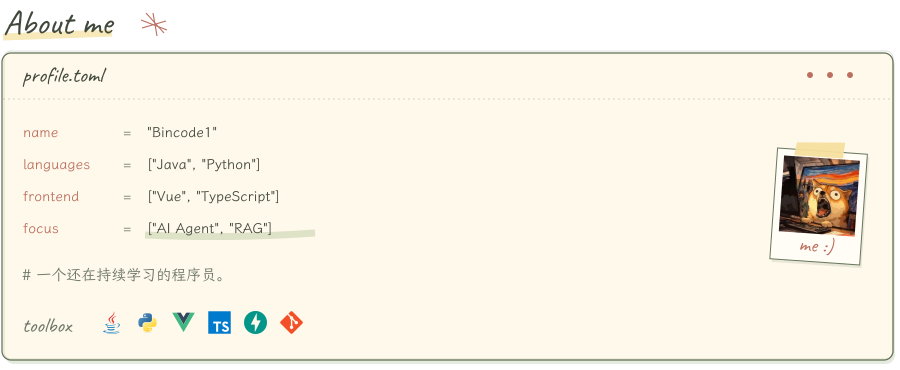
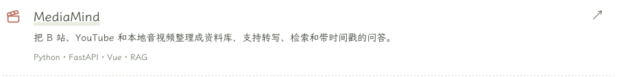
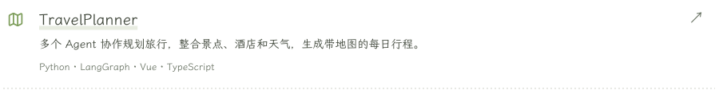
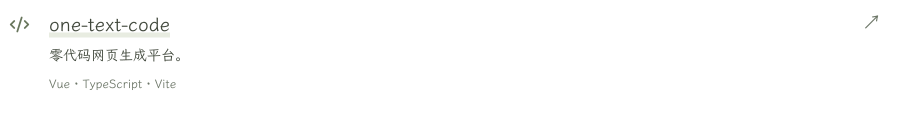

<picture>
  <source media="(max-width: 600px) and (prefers-color-scheme: dark)" srcset="assets/profile/about-mobile-dark.svg">
  <source media="(max-width: 600px)" srcset="assets/profile/about-mobile-light.svg">
  <source media="(prefers-color-scheme: dark)" srcset="assets/profile/about-dark.svg">
  
</picture>

<picture>
  <source media="(max-width: 600px) and (prefers-color-scheme: dark)" srcset="assets/profile/projects-mobile-dark.svg">
  <source media="(max-width: 600px)" srcset="assets/profile/projects-mobile-light.svg">
  <source media="(prefers-color-scheme: dark)" srcset="assets/profile/projects-dark.svg">
  
</picture>

<a href="https://github.com/Bincode1/MediaMind">
<picture>
  <source media="(max-width: 600px) and (prefers-color-scheme: dark)" srcset="assets/profile/project-1-mobile-dark.svg">
  <source media="(max-width: 600px)" srcset="assets/profile/project-1-mobile-light.svg">
  <source media="(prefers-color-scheme: dark)" srcset="assets/profile/project-1-dark.svg">
  
</picture>
</a>

<a href="https://github.com/Bincode1/TravelPlanner">
<picture>
  <source media="(max-width: 600px) and (prefers-color-scheme: dark)" srcset="assets/profile/project-2-mobile-dark.svg">
  <source media="(max-width: 600px)" srcset="assets/profile/project-2-mobile-light.svg">
  <source media="(prefers-color-scheme: dark)" srcset="assets/profile/project-2-dark.svg">
  
</picture>
</a>

<a href="https://github.com/Bincode1/one-text-code">
<picture>
  <source media="(max-width: 600px) and (prefers-color-scheme: dark)" srcset="assets/profile/project-3-mobile-dark.svg">
  <source media="(max-width: 600px)" srcset="assets/profile/project-3-mobile-light.svg">
  <source media="(prefers-color-scheme: dark)" srcset="assets/profile/project-3-dark.svg">
  
</picture>
</a>

[全部项目 ↗](https://github.com/Bincode1?tab=repositories)

<picture>
  <source media="(max-width: 600px) and (prefers-color-scheme: dark)" srcset="assets/activity-mobile-dark.svg">
  <source media="(max-width: 600px)" srcset="assets/activity-mobile-light.svg">
  <source media="(prefers-color-scheme: dark)" srcset="assets/activity-dark.svg">
  
</picture>

更新于 2026-11-15 20:44（UTC+8） · 公开贡献 · 每小时自动刷新
