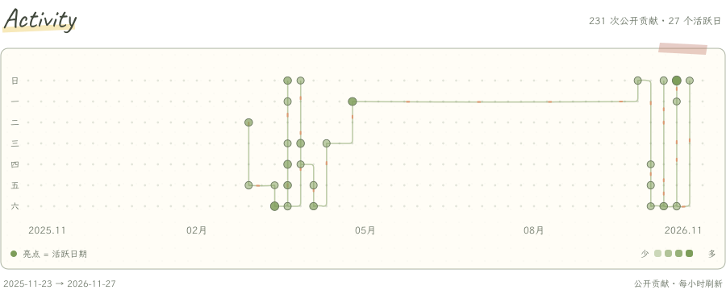

### Hello, 我是 Bincode1! 👋

<p>&nbsp;&nbsp;&nbsp;&nbsp;&nbsp;&nbsp;&nbsp;&nbsp;&nbsp;&nbsp;&nbsp;&nbsp;</p>

#### About me

```text
一个还在持续学习的程序员。
主要学习和实践 Java、Python、Vue。
最近在做 AI Agent、RAG 和网页生成。
```

#### Projects

<table width="100%">
<tr>
<td width="72" align="center"></td>
<td width="800">
<a href="https://github.com/Bincode1/MediaMind"><strong>MediaMind</strong></a><br>
把 B 站、YouTube 和本地音视频整理成资料库，支持转写、检索和带时间戳的问答。<br>
<sub>Python · FastAPI · Vue · RAG</sub>
</td>
</tr>
<tr>
<td width="72" align="center"></td>
<td width="800">
<a href="https://github.com/Bincode1/TravelPlanner"><strong>TravelPlanner</strong></a><br>
多个 Agent 协作规划旅行，整合景点、酒店和天气，生成带地图的每日行程。<br>
<sub>Python · LangGraph · Vue · TypeScript</sub>
</td>
</tr>
<tr>
<td width="72" align="center"></td>
<td width="800">
<a href="https://github.com/Bincode1/one-text-code"><strong>one-text-code</strong></a><br>
零代码网页生成平台。<br>
<sub>Vue · TypeScript · Vite</sub>
</td>
</tr>
</table>

[全部项目 ↗](https://github.com/Bincode1?tab=repositories)

#### Activity

<picture>
  <source media="(prefers-color-scheme: dark)" srcset="assets/activity-dark.svg">
  <source media="(prefers-color-scheme: light)" srcset="assets/activity-light.svg">
  
</picture>
