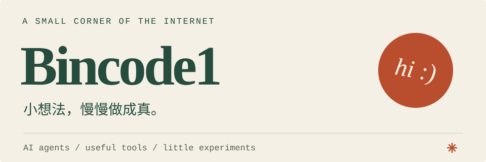

<picture>
  <source media="(max-width: 600px) and (prefers-color-scheme: dark)" srcset="assets/hello-mobile-dark.svg">
  <source media="(max-width: 600px)" srcset="assets/hello-mobile-light.svg">
  <source media="(prefers-color-scheme: dark)" srcset="assets/hello-dark.svg">
  <source media="(prefers-color-scheme: light)" srcset="assets/hello-light.svg">
  
</picture>

 

嗨，我是 **Bincode1**。欢迎来坐坐 🍊

对 **AI Agent、RAG** 和各种能省点事的小工具很好奇。喜欢边学边做，把「要不试试？」变成一个能运行的项目。

**最近的兴趣，都写进了代码里**

让 Agent 学会分工，让知识更好找，也让日常的小麻烦少一点。

`Python` `TypeScript` `Vue` `FastAPI` `LangGraph`

 

## 放在这里，慢慢长大 🌱

**[TravelPlanner ↗](https://github.com/Bincode1/TravelPlanner)** &nbsp; / &nbsp; 下一站，去哪儿？

让多个 Agent 一起查景点、看天气、挑酒店，把旅行想法整理成带地图的多日行程。

多 Agent 协作 · 旅行规划 · 地图可视化

 

**[MediaMind ↗](https://github.com/Bincode1/MediaMind)** &nbsp; / &nbsp; 给看过的留个索引。

把 B 站、YouTube 和本地音视频收进知识工作台。转写、检索、追问，回答还能找到对应的时间戳。

媒体知识库 · RAG · Research Assistant

 

**[skills-hub ↗](https://github.com/Bincode1/skills-hub)** &nbsp; / &nbsp; 小工具的收纳架。

给 Skills 和团队小工具搭了一个收纳架，可以搜索、筛选、查看详情和下载。

Skills · 工具整理 · 搜索与筛选

 

[还有一些实验，欢迎随便逛逛 →](https://github.com/Bincode1?tab=repositories)

---

**有共同感兴趣的东西？** 欢迎在项目的 [Issues](https://github.com/Bincode1/Bincode1/issues) 里聊聊。

这个角落持续施工中。小步前进，也算前进。 ☺
